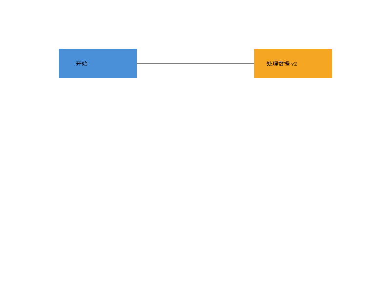

# Lab1 — SVG CLI 编辑器

TypeScript 面向对象课程作业：六种 SVG 图形、嵌套容器、19 个 CLI 命令、事务编辑与撤销重做。

架构方案、阶段记录、验收清单与一致性自查见 [doc/README.md](doc/README.md)。

按“方案 → 领域模型 → Command → CLI → SVG IO → 验收”逐步开发，每阶段独立提交并推送；`final` 指向最终验收版本。

## 启动

需要 Node.js 22+ 和 npm。在本项目目录执行：

```sh
npm ci
npm run cli
```

本机已安装依赖，Windows 也可双击根目录 **run-cli.cmd**，或者在 PowerShell 运行 `./run-cli.cmd`。该入口会编译再启动；只在当前进程查找 Node，不修改系统配置。首次从远程克隆的新环境仍须先安装依赖。

```text
svg> init 800 600
svg> create g scene
svg> create rect r1 10 20 100 50 #4a90d9 in scene
svg> create text t1 30 50 "开始" in scene
svg> move scene 20 0
svg> undo
svg> tree
svg> save demo.svg
```

把保存的 SVG 拖进浏览器预览。输入 `help` 查看所有命令；按 Ctrl+C 或 EOF 退出。

## 支持的命令

| 类别 | 命令 |
| --- | --- |
| 文档 | init、read、save、canvas |
| 编辑 | create、delete、move、scale、set、group、ungroup、addto、front、back |
| 显示 | tree、show、help |
| 历史 | undo、redo |

支持 rect、circle、ellipse、line、text、g。id 全局唯一且大小写敏感，文字和带空格路径用双引号。只有以 # 开头的整行是注释，颜色中的 # 保留。

一条编辑命令对应一次撤销；失败命令不改变文档、保存路径或历史。成功 init/read/save 和 canvas 修改尺寸会清空并锁定历史，直到下一次成功编辑。顶层 g 禁止 ungroup；front/back 仅调整同级顺序。

## 验证与示例

```sh
npm test
npm run check
```

测试包含领域行为、Command 历史、失败原子性、XML round-trip、真实 CLI 子进程及架构依赖检查。持续集成配置覆盖 Windows / Ubuntu 与 Node 22 / 24。

回放题目中的两节点流程图：

```powershell
Get-Content -Encoding utf8 examples/flowchart.txt | node dist/src/main.js
```

macOS / Linux：`node dist/src/main.js < examples/flowchart.txt`。先运行 `npm run build`。脚本会生成 `examples/flowchart.svg`，仓库已附同一输出。



`examples/transcript.txt` 回放题目典型会话，其中两条错误是题目故意演示的；导入样本为 `examples/other.svg`。

## 架构与范围

采用 Command、Composite、Memento、集中工厂和 IO 端口。详细职责、依赖图、设计取舍、真实迭代记录与验收证据见 [doc/README.md](doc/README.md)。

本阶段不实现 box 或插件加载。SVG 导入覆盖上述六种元素、unitless/px 几何及 translate/正等比 scale；不支持的元素、旋转、非等比变换、复杂尺寸 CSS 或非 1:1 viewBox 会明确报错。完整边界见设计文档。

仓库不保存账号密码或授权凭据。node_modules、dist 和本机临时工具 .tools 均被忽略。
