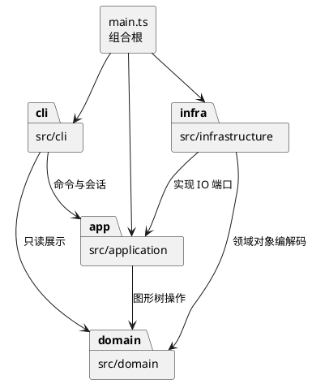

# Lab1 Phase 1：设计与开发记录

## 架构方案

### 范围与验收基线

实现 TypeScript CLI，内置 rect / circle / ellipse / line / text / g 六种图形，以及题目全部文档、编辑、显示和历史命令。box 和动态插件加载属于后续阶段；本次 create box 报未知类型。

生产代码采用字段封装、类层次、多态、一类一文件。入口仅组装依赖，不用公共数据袋与自由函数代替领域对象。

### 模块划分与依赖方向

| 目录 | 职责 | 可以依赖 |
| --- | --- | --- |
| src/domain/ | 六种图形、Composite 树、文档不变量、几何操作 | 本模块；不依赖 Node、XML 库或 CLI |
| src/application/ | 会话、Command、历史、工厂、参数校验和 IO 端口 | domain、本模块 |
| src/infrastructure/ | SVG/XML 编解码与文件系统适配 | domain、application 端口、Node、XML 库 |
| src/cli/ | REPL、分词、命令注册与解析 | application、domain 只读查询 |
| src/main.ts | 组合根，实例化对象并启动 CLI | 所有模块 |
| test/ | 模型、历史、CLI、IO、真实进程和架构验收 | 被测模块、Node 测试库 |
| examples/ | 可回放脚本和 SVG 输入 | 无 |

保护领域模型：替换终端、文件系统或 XML 库不应改变几何行为。application 不能导入 infrastructure；任何反向导入均为待修复项。

### 设计模式的选择与落地计划

1. **Command（必须）**：编辑行为各由独立命令类封装，历史管理器调用 execute / undo / redo。CLI 只构造对象，不实现几何逻辑。
2. **Composite**：Shape 定义共同操作；Group 持有子图形，递归移动、缩放。命令统一处理容器和叶子，不按标签分支。
3. **Memento**：编辑在文档副本上执行，成功才发布并记录前后快照。undo/redo 恢复快照，避免逆操作遗漏父级、顺序或浮点精度。单次 O(n) 复制和额外内存是本阶段接受的取舍。
4. **Factory / 注册表**：图形类型与命令名分别集中映射到构造行为。
5. **端口与适配器**：文件系统与 XML 在外层，通过存储接口接入。

**仅两处按名字分派**：CLI 命令注册表与图形工厂。按题目要求，标为后续待重构点：下一阶段改由插件声明注册项。本次不做动态加载和插件生命周期。属性白名单查表仅用于属性校验，不根据图形类型分派业务行为。

### 变化点假设

| 变化点 | 预留方式 / 决定不做的原因 |
| --- | --- |
| 新图形及 box 插件 | Shape 多态与集中工厂；暂不实现插件协议，避免超出范围 |
| CLI 换 GUI / agent | Command、历史、领域模型独立于 REPL |
| 更换格式与 IO | 存储端口隔离 infrastructure |
| 大文档历史 | 历史策略隔离，可换差量；当前优先正确性 |
| 更多展示属性 | 导入附加 SVG 属性保留；CLI set 严格遵守白名单 |

### 题目未完全规定的行为：本次约定

- group 以原文档深度优先顺序收入子树。同父级新组插在首个选中项处；跨父级挂到最近共同父容器，插到最早相关分支之前。含祖先和后代的选择整体拒绝。
- front 移到 SVG 同级数组末尾（后绘制），back 移到开头。
- g 的样式设在容器上，遵循 SVG 继承，不覆盖子节点显式样式。
- 成功 IO 清空并锁定历史；下一次成功编辑解锁。显示、失败、canvas 查询不改变历史。
- save file 成功后记住路径；init 后首次 save 必须给路径。help 可在无文档时使用。
- 数值有限；画布与 scale 因子为正；图形尺寸、半径和 stroke-width 非负。
- 读入预扫描全部显式 id，再补缺失 id，避免与后文 id 冲突。未知元素或无法可靠编辑的变换明确报错，不能静默丢图。
- 支持背景示例的 translate、正等比 scale，导入时规范化到几何坐标。其他变换（如旋转）原子拒绝；本阶段不承诺完整 SVG 标准覆盖。

## 过程记录

### 阶段 1：需求与方案（2026-10-26）

- 用户要求分阶段完成，禁止 one-shot。范围固定在本仓库，不改其他项目或全局 Git、Node、代理配置。
- 明确 box 不属本阶段、顶层 g 禁止 ungroup、颜色 # 不能当行内注释。
- 先记录方案与边界，再实现。采用 Command + 副本提交，确保 group/delete/addto 恢复树结构和顺序。
- 当前为开发前方案，尚未把计划描述为验证结果。

### 计划提交阶段

1. 架构与验收基线。
2. TypeScript 工程、领域模型与 Composite 测试。
3. Command、事务编辑、历史与树操作测试。
4. CLI 分词、注册分发和输出。
5. SVG 读写、缺失 id、文件错误与 round-trip。
6. 真实进程回放、边界修复、使用说明、一致性自查。
7. 检查通过后推送最终提交并创建 final 标签。

## 一致性自查

开发前：尚无生产代码。最终按实际目录和 import 关系填写结果；架构修订留下原因。

## 质量保证手段

### 验收清单（待实现）

- [ ] strict TypeScript 编译；一类一文件、字段封装与多态。
- [ ] 六种图形、白名单、浮点、中文、空文字与引号。
- [ ] 全局大小写敏感 id；子树和导入保持唯一性。
- [ ] 全部编辑命令、嵌套、顺序、循环与顶层解组限制。
- [ ] 每命令一个历史单元、失败原子性、redo 分支、IO 屏障。
- [ ] XML 嵌套、转义、默认样式、重复/缺失 id、损坏文件。
- [ ] save/read/save 保持图形、结构与支持的显示属性。
- [ ] 典型会话与流程图 A 回放，保存的 SVG 可预览。
- [ ] 错误统一单行 error；错误后 REPL 继续。
- [ ] 依赖抽查与自动检查；本地/远程提交和 final 标签一致。

课程截止时间尚未提供。final 使用真实完成时间创建，不回填时间、不虚构开发或人工审核记录。
