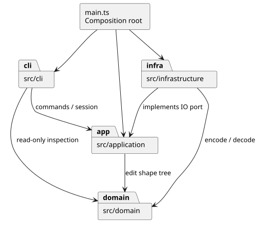
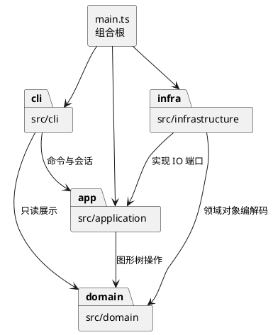

# Lab1 Phase 1：设计与开发记录

## 架构方案

### 范围与验收基线

实现 TypeScript CLI，内置 rect / circle / ellipse / line / text / g 六种图形，以及题目全部文档、编辑、显示和历史命令。box 和动态插件加载属于后续阶段；本次 create box 报未知类型。

生产代码采用字段封装、类层次、多态、一类一文件。入口仅组装依赖，不用公共数据袋与自由函数代替领域对象。

### 模块划分与依赖方向

| 目录 | 职责 | 可以依赖 |
| --- | --- | --- |
| src/domain/ | 六种图形、Composite 树、文档不变量、几何操作 | 本模块；不依赖 Node、XML 库或 CLI |
| src/application/ | 会话、Command、历史、工厂、参数校验和 IO 端口 | domain、本模块 |
| src/infrastructure/ | SVG/XML 编解码与文件系统适配 | domain、application 端口、Node、XML 库 |
| src/cli/ | REPL、分词、命令注册与解析 | application、domain 只读查询 |
| src/main.ts | 组合根，实例化对象并启动 CLI | 所有模块 |
| test/ | 模型、历史、CLI、IO、真实进程和架构验收 | 被测模块、Node 测试库 |
| examples/ | 可回放脚本和 SVG 输入 | 无 |

可复用的 PlantUML 源文件见 [architecture.puml](architecture.puml)。

保护领域模型：替换终端、文件系统或 XML 库不应改变几何行为。application 不能导入 infrastructure；任何反向导入均为待修复项。

### 设计模式的选择与代码落地

1. **Command（必须）**：编辑行为各由独立命令类封装，历史管理器调用 execute / undo / redo。CLI 只构造对象，不实现几何逻辑。
2. **Composite**：Shape 定义共同操作；Group 持有子图形，递归移动、缩放。命令统一处理容器和叶子，不按标签分支。
3. **Memento**：编辑在文档副本上执行，成功才发布并记录前后快照。undo/redo 恢复快照，避免逆操作遗漏父级、顺序或浮点精度。单次 O(n) 复制和额外内存是本阶段接受的取舍。
4. **Factory / 注册表**：图形类型与命令名分别集中映射到构造行为。
5. **端口与适配器**：文件系统与 XML 在外层，通过存储接口接入。

| 模式 | 实际类 / 代码位置 |
| --- | --- |
| Command | application/EditCommand.ts、commands/ 中 10 个具体编辑命令；History 调用 execute/undo/redo |
| Composite | domain/Shape.ts、Group.ts 与五种叶子；move/scale/clone 均通过多态递归 |
| Memento | EditCommand 内私有 before/after 文档快照；SvgDocument.clone 深复制整棵树 |
| Factory / 注册表 | application/ShapeFactory.ts、cli/CommandDispatcher.ts |
| IO 端口 | application/SvgStore.ts；infrastructure/FileSvgStore.ts 实现，SvgCodec 负责 XML |

**仅两处按名字分派**：CLI 命令注册表与图形工厂。按题目要求，标为后续待重构点：下一阶段改由插件声明注册项。本次不做动态加载和插件生命周期。属性白名单查表仅用于属性校验，不根据图形类型分派业务行为。

### 变化点假设

| 变化点 | 预留方式 / 决定不做的原因 |
| --- | --- |
| 新图形及 box 插件 | Shape 多态与集中工厂；暂不实现插件协议，避免超出范围 |
| CLI 换 GUI / agent | Command、历史、领域模型独立于 REPL |
| 更换格式与 IO | 存储端口隔离 infrastructure |
| 大文档历史 | 历史策略隔离，可换差量；当前优先正确性 |
| 更多展示属性 | 导入附加 SVG 属性保留；CLI set 严格遵守白名单 |

### 题目未完全规定的行为：本次约定

- group 以原文档深度优先顺序收入子树。同父级新组插在首个选中项处；跨父级挂到最近共同父容器，插到最早相关分支之前。含祖先和后代的选择整体拒绝。
- front 移到 SVG 同级数组末尾（后绘制），back 移到开头。
- g 的样式设在容器上，遵循 SVG 继承，不覆盖子节点显式样式。
- 成功 IO 清空并锁定历史；下一次成功编辑解锁。显示、失败、canvas 查询不改变历史。
- save file 成功后记住路径；init 后首次 save 必须给路径。help 可在无文档时使用。
- 数值有限；画布与 scale 因子为正；图形尺寸、半径和 stroke-width 非负。
- 读入预扫描全部显式 id，再补缺失 id，避免与后文 id 冲突。未知元素或无法可靠编辑的变换明确报错，不能静默丢图。
- 支持背景示例的 translate、正等比 scale，导入时规范化到几何坐标。其他变换（如旋转）原子拒绝；本阶段不承诺完整 SVG 标准覆盖。

## 过程记录

### 阶段 1：需求与方案（2026-10-26）

- 用户要求分阶段完成，禁止 one-shot。范围固定在本仓库，不改其他项目或全局 Git、Node、代理配置。
- 明确 box 不属本阶段、顶层 g 禁止 ungroup、颜色 # 不能当行内注释。
- 先记录方案与边界，再实现。采用 Command + 副本提交，确保 group/delete/addto 恢复树结构和顺序。
- 此阶段提交的是开发前方案，当时尚未把计划描述为验证结果；后续记录保留实际实现和验证结果。

### 阶段 2：工程与领域模型（2026-10-26）

- 落地 Shape、五种叶子和 Group；私有集合封装属性与子节点，clone 使用多态复制，无标签分派。
- SvgDocument 负责全局 id、最近共同父级分组、循环校验与同级顺序。避免额外 id 缓存，以遍历换取简单一致性。
- strict 编译通过，6 项领域测试通过：六类型几何、属性错误、克隆隔离、全局 id、分组与解组、跨父级顺序和循环。
- 本机原有 Node 但无 npm，在被忽略的 .tools 中准备官方 npm；未改系统 PATH 或其他项目。依赖通过 package-lock.json 固定。

### 阶段 3：Command 与事务历史（2026-10-26）

- 实现每个编辑命令的独立类，EditCommand 模板方法隔离副本提交，History 只管理命令与 IO 屏障。
- SvgStore 以接口定义读写端口；EditorSession 只在成功 IO 后更新路径和历史。
- strict 编译与累计 14 项测试通过。专门构造组内第二个图形移动时溢出，确认第一个图形的修改不会泄漏；结构操作逐条验证 undo/redo 精确恢复父级与顺序。
- 失败编辑保留 redo，失败 IO 保留历史；成功 save 记住路径；init/resize 参数失败不会替换旧文档。

### 阶段 4：CLI 与脚本回放（2026-10-26）

- 分词器保留引号信息，区分文字 in 和归属子句；仅整行 # 注释，颜色、Windows 路径、空字符串和转义引号均有测试。
- 命令注册表集中声明全部 19 个命令，错误统一压成单行；TreeFormatter 不按图形类型分支。
- Repl 通过流接入 Node readline（CLI 允许依赖交互相关 Node 模块，禁止文件系统读写）；支持交互提示符和顺序管道回放。
- strict 编译及累计 21 项测试通过，涵盖题目指定错误、查询不污染历史、错误后继续执行。

### 阶段 5：SVG 与文件 IO（2026-10-26）

- 使用 @xmldom/xmldom 的 DOMParser / XMLSerializer，解析警告也按错误处理，不使用正则解析 XML。
- 预扫描显式 id 后补名，保留文本和附加展示属性。文件保存采用同目录临时文件与 rename，失败后清理临时文件。
- translate、正等比 scale 规范化到叶子；同时处理继承的字体大小和描边宽度，避免只改坐标导致外观失真。
- 为保证可编辑性，明确拒绝非 1:1 viewBox、旋转/非等比变换、DOCTYPE、未知元素、叶子内嵌子元素及变换下含复杂尺寸 CSS 的情况。支持 unitless / px 几何；不承诺 SVG 全标准。
- strict 编译与累计 31 项测试通过，含真实临时目录读写、带空格路径、重复保存、失败导入与历史保持。添加题目输入 other.svg 及两份回放脚本。

### 阶段 6：真实回放与边界修复（2026-10-26）

- 使用独立 Node 子进程、真实文件和 EOF 回放典型会话与两节点流程图 A；典型会话恰有题目预期的两条错误，流程图无错误并保存 8 个元素。
- 新回归测试先失败，确认 root SVG 的 id 未被后续 create/group 预留；在 SvgDocument 集中修复。另一个先失败的用例确认 rect 内非空文字会被静默丢弃，现对所有非 text 元素统一拒绝游离文字。
- 编写自动目录/导入检查并抽查领域类与命令类。当前安装的 TypeScript 7 包未提供旧 createSourceFile API，因此不引入额外解析依赖，改用源码声明/import 静态扫描。扫描适用于本仓库的静态导入写法，不宣称覆盖任意 TypeScript 语法。
- strict 编译、39 项测试通过，包含 3 项真实进程验收、2 项架构检查和 3 项补充回归。未把生成阶段记录伪装成人工发现；这里的审查、修复和测试由 AI 实际执行。

### 阶段 7：交付整理（2026-10-26）

- 提供 README 使用方法、Windows run-cli.cmd 和可读 PlantUML 源文件；示例 SVG 由真实 CLI 生成。
- 在真实终端确认 svg> 提示符、创建、移动、撤销和 tree；对生成的 SVG 使用系统已有 sharp 渲染并查看 PNG，确认矩形、中文和连线可见。渲染工具不成为项目依赖。
- 包脚本直接调用本地 tsc，避免嵌套 npm 对本机 PATH 的额外要求。
- 重新 npm ci 后，39 项测试和 npm run check 通过；直接调用 npm run cli 与 Windows run-cli.cmd 均成功启动并正常读到 EOF。
- 增加 GitHub Actions 配置，并在 Windows/Ubuntu、Node 22/24 四个环境下以 npm ci + npm test 验证，四组均成功；见下方实际运行记录。

阶段 1–7 的可核对提交依次为 2679f8f、dc8c6a7、c205ec9、79f81b6、71eedd4、3992898、d1424e2。本次验收记录作为最后一个独立文档提交，final 标签指向验收完成后的最终提交。

## 一致性自查

1. **模块划分一致**：src 下实际为 domain/application/infrastructure/cli 四个模块和 main.ts 组合根；commands 是 application 内部子目录。没有为未来 box 提前创建插件目录。
2. **依赖方向符合规则**：自动扫描当前全部静态 import，未发现反向依赖；domain/application 没有 Node 或 XML 库导入。CLI 只用 Node readline/stream，文件 IO 全部位于 infrastructure。CLI 使用 Node 交互模块这一允许项已在阶段 4 修订说明。
3. **人工式抽查由 AI 执行**：MoveCommand 仅调用 Shape.move；Group 递归调用子对象 move/scale；EditorSession 仅依赖 SvgStore 接口；FileSvgStore 通过接口被组合根注入，application 不认识其具体类。
4. **范式检查**：每个生产类与文件同名，一个文件最多一个类；无顶层自由函数和 switch。SvgStore.ts 仅声明端口/返回 DTO；main.ts 仅为组合根。DTO 和分词结果不承担领域行为，领域对象的状态保留在封装类中。
5. **待重构项仍明确保留**：工厂/命令集中注册改为插件注册；全量快照换差量以支持大文档。当前没有违反层级的遗留依赖。

## 质量保证手段

### 本地验收结果

Node 24.19.0、TypeScript 7.0.2、@xmldom/xmldom 0.9.12；严格编译通过，39 项自动测试通过。

| 测试文件 | 证明的行为 |
| --- | --- |
| domain.test.ts（6） | 六类型几何、克隆隔离、属性校验、id、树结构和顺序 |
| history.test.ts（8） | 原子失败、精确撤销、全部结构编辑、redo 分支、IO 成败屏障 |
| cli.test.ts（7） | 引号/颜色/路径、19 命令帮助、指定错误、展示与流回放 |
| io.test.ts（10） | XML 与文件 round-trip、id 补全、变换、失败保持、保存路径 |
| integration.test.ts（3） | 真实 Node 进程执行题目会话、流程图和全部编辑流程 |
| architecture.test.ts（2） | 文件/类命名、静态 import 层级、无自由函数与 switch |
| regression.test.ts（3） | 根 id 冲突、非 text 内容、box 标记降级 |

- [x] strict 编译与面向对象约束。
- [x] 六种图形、白名单、浮点、中文、空文字和引号。
- [x] 全局大小写敏感 id，导入补名避让。
- [x] 全部命令、嵌套、顺序、循环和顶层解组限制。
- [x] 一条编辑一次历史、失败原子性、redo 分支和 IO 屏障。
- [x] XML 转义、默认属性、损坏文件与 round-trip。
- [x] 题目两个会话真实回放，输出 SVG 实际渲染检查。
- [x] 错误单行前缀且 REPL 继续。
- [x] 架构规则静态扫描与抽查。

本地结果不等同于全 SVG 标准验证；有限导入范围与 O(n) 快照内存取舍已在架构方案中说明。PlantUML 与 CI 的使用方式参考其官方格式；依赖行为通过已安装代码与类型声明核对。

### 云端验收证据

[GitHub Actions 运行 40288884510](https://github.com/eqepety/-lab1-svg-/actions/runs/40288884510) 对应 d1424e2：Ubuntu/Node 22、Ubuntu/Node 24、Windows/Node 22、Windows/Node 24 全部 success。每个作业从干净环境执行 npm ci 与 npm test，覆盖相同的 39 项测试。本验收记录之后没有修改生产代码。

标签与分支一致性可复核：`git rev-parse HEAD`、`git rev-parse final^{commit}` 和远程 `git ls-remote origin refs/heads/main refs/tags/final^{}` 应指向同一提交。annotated final 标签使用真实创建时间。

课程截止时间尚未提供。final 使用真实完成时间创建，不回填时间、不虚构开发或人工审核记录。
